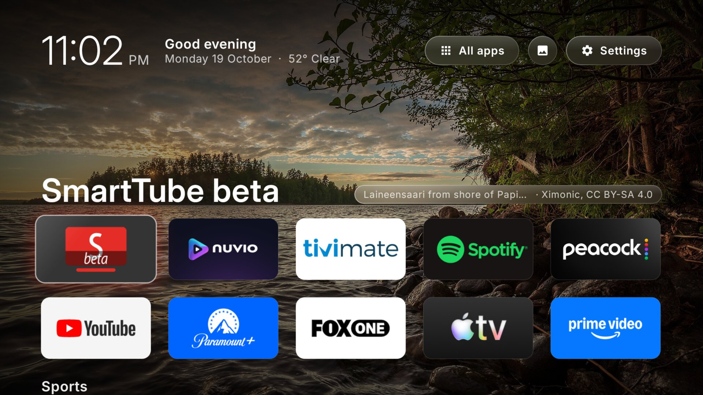
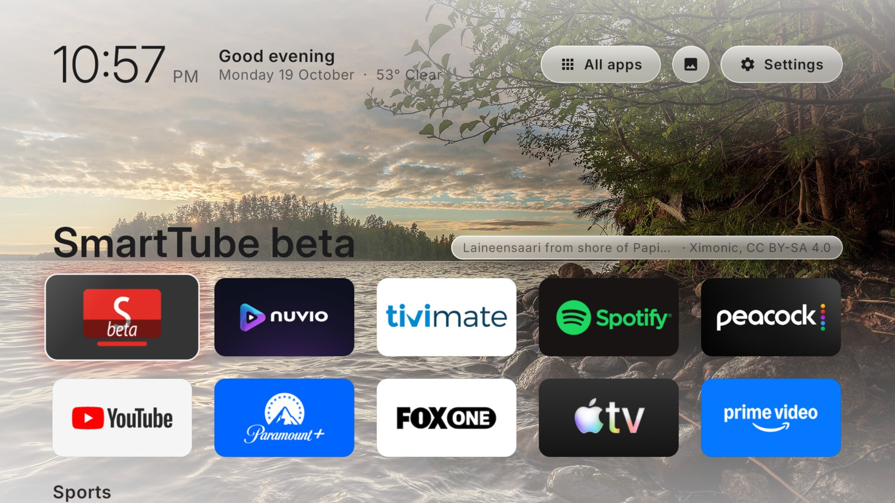
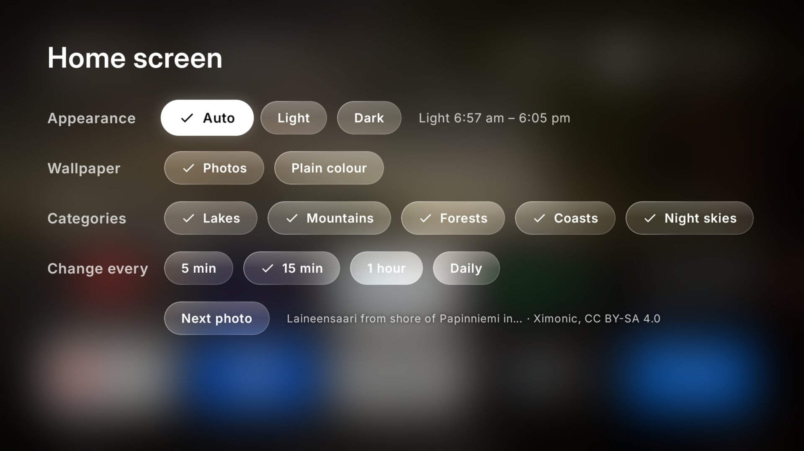
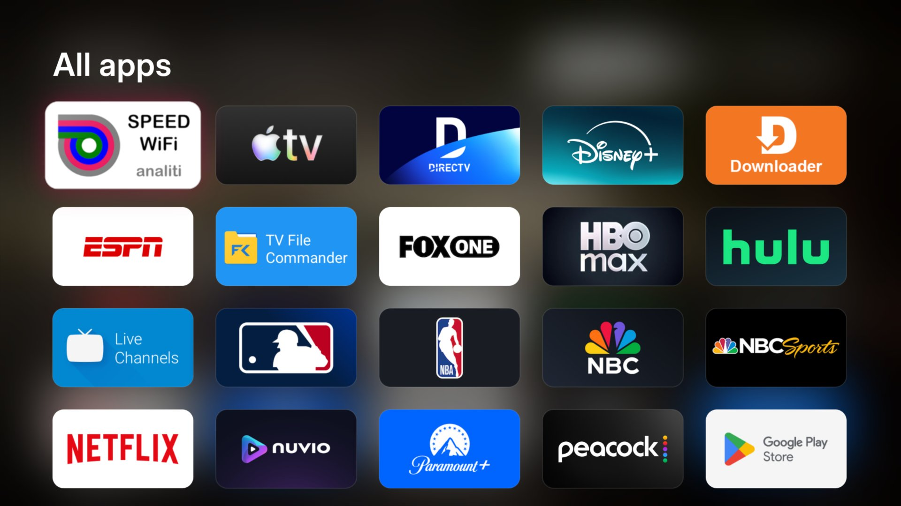
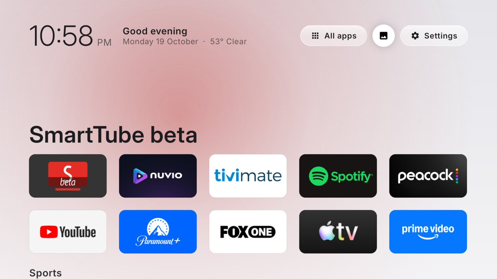

# Android TV: Debloat + Custom Launcher

Remove the bloatware and ads from an Android TV, and replace the stock home screen with a clean, Apple TV-style launcher over rotating landscape photos. No root, no USB cable, and everything is reversible.

Written up end to end here: [How I Debloated My Android TV and Built My Own Launcher With Claude Code](https://princejain.me/blogs/debloat-android-tv-custom-launcher-claude-code).



| | |
|---|---|
|  |  |
| **Light mode** by day, switched at sunrise and sunset | **Home screen panel**, behind the photo button |
|  |  |
| **All apps** | **Plain colour** instead of a photo |

## Features

- **Apple TV-style look.** Frosted glass buttons, rows that run off the screen edge, focus shown by a lift and a glow in the app's colour (no thick borders), and the [Inter](https://rsms.me/inter/) font in text and display sizes.
- **Wallpapers.** Featured photos from [Wikimedia Commons](https://commons.wikimedia.org/) fill the screen: lakes, mountains, forests, coasts and night skies. A new photo fades in every 5 minutes, 15 minutes, hour or day, and its title, author and licence sit next to the app name. The next photo downloads ahead of time, so after a restart the last one is back at once, even offline. If you prefer, choose a plain background instead.
- **Light by day, dark at night.** Auto switches at sunrise and sunset where the TV is. The TV works the times out from its location, with no network call. You can also keep it on Light or Dark.
- **Live sports** (optional). A row of live, upcoming and recent games from ESPN's free scoreboard (no key), your teams first. Selecting a game opens the app that carries it (ESPN, Fox One, Peacock, Paramount+, HBO Max, Prime Video, Apple TV…). It only refreshes while the home screen is showing: every minute during live games, otherwise every 15 minutes.
- **Your apps, your order.** Two rows of favourites, and every app in the **All apps** panel. Long-press any tile to **move it, add it to or remove it from favourites**, or open App info.
- **Recent** row of your most-used apps (favourites left out, since they're one row up).
- **Header**: clock, greeting, date and weather ([Open-Meteo](https://open-meteo.com/), no key needed), and buttons for Inputs, All apps, Home screen and Settings. Picture and Sound buttons appear when the TV has those settings screens.
- **Inputs panel** on TVs: the connected HDMI inputs, named after the device where the TV reports it (for example "Apple TV · HDMI 1"). The button is hidden when nothing is connected, so streaming boxes never show it.
- **Home screen panel** (the photo button): appearance (Auto, Light or Dark, where Auto shows today's light hours), photos or a plain colour, which categories to show, how often to change the photo, and **Next photo**.
- **OLED care**: a pure black background in dark mode, the layout drifts a few pixels every two minutes, and the screen dims after a minute of no input and 25% at night. One switch turns it off on LCD TVs.

## What's inside

```text
debloat/
  debloat.sh                hide every app in a list (reversible)
  restore.sh                bring one app, or all of them, back
  packages.txt              your removal list (empty template)
  examples/xiaomi-tv.txt    the 32 packages removed from a Xiaomi OLED TV
launcher/                   the home screen (Kotlin + Jetpack Compose for TV)
  local.properties.example  SDK path and the optional sports settings
  third_party/Inter-OFL.txt licence for the bundled Inter font
```

## What you need

- An Android TV or Google TV (a TV with Android built in, or a streaming box) on Android 9 or later.
- A laptop on the same Wi-Fi.
- [ADB](https://developer.android.com/tools/adb) (`brew install --cask android-platform-tools` on a Mac).
- For the launcher: [Android Studio](https://developer.android.com/studio) (free), which provides the JDK and Android SDK. You never have to open it.
- Optional but recommended: a coding agent such as [Claude Code](https://docs.claude.com/en/docs/claude-code/overview) to do all of this for you.

## The easy way: let a coding agent do it

Open your coding agent in this folder and paste:

```text
I want to debloat my Android TV and install the custom launcher in this repo. This is a TV I own.
Developer mode and USB debugging are on. TV IP: <your TV's IP>. Same Wi-Fi as this laptop.
Apps I use: <e.g. Netflix, Prime Video, YouTube>.

Read README.md and CLAUDE.md first. Connect over ADB, list every installed app grouped by category,
and mark what's bloat, what's safe to keep and what must never be removed. Ask me before removing
anything. Then set my favourites, build the launcher, install it and make it the home screen.
```

## The manual way

### 1. Turn on developer mode (on the TV)

1. **Settings → Device Preferences → About**, click **Build** seven times.
2. **Developer options** → turn on **USB debugging**, and **Wireless debugging** if your TV has it.
3. Note the TV's IP from **Settings → Network**, or from the Wireless debugging screen.

Then connect from your laptop. Which command depends on the TV:

```bash
# Most Android TVs (Android 9–11): USB debugging also opens network debugging on port 5555
adb connect <tv-ip>:5555

# TVs with "Wireless debugging" (Google TV, Android 11+): pair once, then connect to the port it shows
# On the TV: Wireless debugging → "Pair device with pairing code" shows an IP:port and a 6-digit code
adb pair <tv-ip>:<pairing-port>        # enter the 6-digit code
adb connect <tv-ip>:<port>             # the port on the main Wireless debugging screen
```

The first time, the TV asks **"Allow USB debugging?"** (or wireless debugging). Tick **"Always allow from this computer"** and press Allow. If you connected with a port other than 5555, pass `<tv-ip>:<port>` wherever this README says `<tv-ip>`.

### 2. Debloat

See what's installed, then put the packages you want gone in `debloat/packages.txt` (one per line). If you have a Xiaomi TV, start from `debloat/examples/xiaomi-tv.txt`.

```bash
adb -s <tv-ip>:5555 shell pm list packages        # everything
adb -s <tv-ip>:5555 shell pm list packages -3     # apps you (or the manufacturer) installed

cd debloat
./debloat.sh <tv-ip>                              # uses packages.txt
./debloat.sh <tv-ip> examples/xiaomi-tv.txt       # or any list
```

Apps are removed with `pm uninstall -k --user 0`, which hides them from your user profile without deleting them from the system. **Never remove** Live TV, chip/vendor services (e.g. `com.mediatek.*`), the remote's Bluetooth service, TV settings, Play Services or the keyboard: doing so can break the remote, the inputs or booting.

### 3. Configure and build the launcher

```bash
cd launcher
cp local.properties.example local.properties
```

Edit `local.properties`:

| Setting | What it does |
|---|---|
| `sdk.dir` | Path to the Android SDK (or set `ANDROID_HOME` instead) |
| `sports.leagues` | Leagues for the Sports row: `nfl`, `nba`, `wnba`, `mlb`, `nhl`, `cfb`, `cbb`, `mls`, `epl`. Empty (with no teams) = no Sports row. College leagues only show ranked teams' games, plus yours |
| `sports.teams` | Your teams, shown first, as `league:ESPN abbreviation`, e.g. `nfl:TEN,epl:EVE`. If a team doesn't play today, its next game in the coming week is shown instead |

`local.properties` is gitignored. Then build:

```bash
./gradlew assembleRelease
```

Always use the **release** build: it's optimised with R8, and debug Compose builds are noticeably slow on TV hardware.

### 4. Install

```bash
S=<tv-ip>:5555                    # or <tv-ip>:<port> if you used Wireless debugging
adb -s $S install -r app/build/outputs/apk/release/app-release.apk
adb -s $S shell pm grant me.prince.launcher android.permission.ACCESS_COARSE_LOCATION   # weather, sunrise and sunset
adb -s $S shell appops set me.prince.launcher GET_USAGE_STATS allow                       # Recent row
adb -s $S shell cmd package compile -m speed -f me.prince.launcher                       # faster cold start
adb -s $S shell am start -n me.prince.launcher/.MainActivity                             # try it first
```

### 5. Make it the home screen

Only once the launcher works:

```bash
adb -s $S shell cmd package set-home-activity me.prince.launcher/.MainActivity
adb -s $S shell input keyevent KEYCODE_HOME
```

If Home still opens the stock launcher, disable it (disabled, not uninstalled, so it can come back). Read the "Ok Google" note in [Gotchas](#gotchas) first.

```bash
adb -s $S shell pm disable-user --user 0 com.google.android.tvlauncher
```

## Customise

- **Favourites:** long-press a tile → Move / Add to favourites / Remove. The order is saved on the TV. The defaults for a fresh install are at the top of `Apps.kt`.
- **Appearance and wallpaper:** press the photo button in the header. Choices are saved on the TV.
- **Wallpaper categories:** `WallpaperCategory` in `Wallpaper.kt` maps each choice to Commons categories of featured pictures. To skip a photo you don't want, add its file title to `EXCLUDED` in the same file.
- **Colours:** `Theme.kt` holds the light and dark sets.
- **OLED care:** set `OLED_CARE = false` at the top of `HomeScreen.kt` on an LCD TV.
- **Font:** replace `res/font/inter.ttf` with any variable font that has `wght` and `opsz` axes.

## Undo everything

```bash
cd debloat
./restore.sh <tv-ip> <package>   # bring one app back
./restore.sh <tv-ip>             # bring back everything in packages.txt and re-enable the stock launcher
adb -s <tv-ip>:5555 uninstall me.prince.launcher
```

If the TV ever shows a black screen on Home, `adb -s <tv-ip>:5555 shell pm enable com.google.android.tvlauncher` brings the stock launcher back.

## Gotchas

- **The stock launcher wins Home.** It's a system app with a higher priority than yours, so `set-home-activity` alone often doesn't stick. Disable it, but only after your launcher is installed and tested, or you get a black screen.
- **Disabling the stock launcher can break "Ok Google"** on TVs with a far-field (hands-free) mic. Android 11+ only lets a background app use the microphone if an app in the foreground lends it that permission, and the stock launcher was doing that for Google Assistant. This repo doesn't include a fix. The voice button on the remote keeps working either way. If hands-free "Ok Google" matters to you, check it after disabling the stock launcher (logcat shows `Request denied by app op: 27` when it's broken), or ask your coding agent to add a microphone-type foreground service that binds the Assistant with `BIND_INCLUDE_CAPABILITIES`.
- **There's no weather, and Auto switches at 7 am and 7 pm.** Both need location permission, so run the `pm grant ... ACCESS_COARSE_LOCATION` line above. They also need the TV to know its location. Some streaming boxes don't, and then the weather is hidden and Auto keeps the 7 am to 7 pm fallback.
- **No photo on the first start.** The launcher shows the plain background until the first photo has downloaded, and tries again every 15 seconds while it's offline.
- **Firmware updates** can bring removed apps back. Re-run `./debloat.sh <tv-ip>`.

## Credits

- Wallpapers from the featured pictures on [Wikimedia Commons](https://commons.wikimedia.org/). Each photo's author and licence (usually CC BY or CC BY-SA) are shown on screen while it's up.
- Weather from [Open-Meteo](https://open-meteo.com/).
- Sunrise and sunset from the equations behind [NOAA's solar calculator](https://gml.noaa.gov/grad/solcalc/).
- [Inter](https://rsms.me/inter/) by Rasmus Andersson, under the SIL Open Font License (`launcher/third_party/Inter-OFL.txt`).

## Licence

[MIT](LICENSE) for the code. The bundled Inter font is under the SIL Open Font License.
